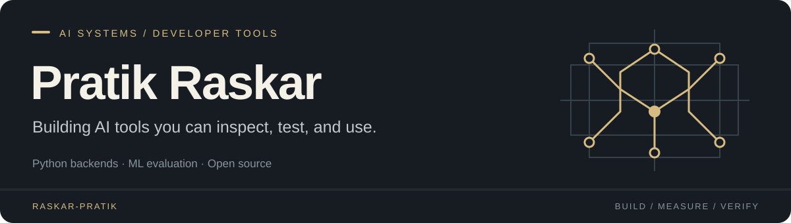

  

  <a href="#selected-work"><strong>Explore my work</strong></a>
  &nbsp; · &nbsp;
  <a href="https://www.linkedin.com/in/pratik-raskar042006/">LinkedIn</a>
  &nbsp; · &nbsp;
  <a href="mailto:pratikrskr1977@gmail.com">Email</a>

I'm **Pratik**, an Artificial Intelligence and Data Science undergraduate at **Sanjivani University, India**. I build Python backends, ML applications, and tools that make technical claims easier to check.

My current work focuses on **LLM evaluation, computer vision integrity, API verification, and model deployment**—from the underlying checks to the interface someone uses to investigate a result.

## Selected work

<table>
<tr>
<td width="50%" valign="top">
<h3><a href="https://github.com/raskar-pratik/modeltrace">ModelTrace</a></h3>

<strong>Compare what an LLM endpoint actually does.</strong>

A local auditing workbench with trusted-reference comparisons, frozen audit configurations, statistical evaluation, and exportable evidence.

<code>Python</code> <code>FastAPI</code> <code>React</code> <code>SciPy</code>

<a href="https://github.com/raskar-pratik/modeltrace">Source</a> · <a href="https://github.com/raskar-pratik/modeltrace/blob/main/STATISTICAL_METHOD.md">Statistical method</a> · <a href="https://github.com/raskar-pratik/modeltrace/blob/main/VALIDATION_REPORT.md">Validation</a>

</td>
<td width="50%" valign="top">
<h3><a href="https://github.com/raskar-pratik/veyra">Veyra</a></h3>

<strong>Trace integrity across a computer vision pipeline.</strong>

A local analyst workstation bringing together dataset checks, model fingerprints, signed inference records, and a tamper-evident audit ledger.

<code>Python</code> <code>Flask</code> <code>PyTorch</code> <code>Ed25519</code>

<a href="https://github.com/raskar-pratik/veyra">Source</a> · <a href="https://github.com/raskar-pratik/veyra/blob/main/docs/architecture.md">Architecture</a> · <a href="https://github.com/raskar-pratik/veyra/blob/main/docs/demo.md">Demo guide</a>

</td>
</tr>
<tr>
<td width="50%" valign="top">
<h3><a href="https://github.com/raskar-pratik/API_Proof">APIProof</a></h3>

<strong>Check API fit before integration.</strong>

A portable coding-agent skill with Python helpers for requirement-level evidence, bounded live probes, and traceable suitability reports.

<code>Python</code> <code>HTTP APIs</code> <code>Agent Skills</code> <code>GitHub Actions</code>

<a href="https://github.com/raskar-pratik/API_Proof">Source</a> · <a href="https://github.com/raskar-pratik/API_Proof#quick-start">Install</a> · <a href="https://github.com/raskar-pratik/API_Proof/blob/main/api-proof/references/evidence-contract.md">Evidence contract</a>

</td>
<td width="50%" valign="top">
<h3><a href="https://github.com/raskar-pratik/uniml">UniML</a></h3>

<strong>Take a model from upload to an inference API.</strong>

A deployment workflow for framework detection, validation, ONNX conversion, benchmarking, and generated FastAPI and Docker packages.

<code>FastAPI</code> <code>ONNX</code> <code>React</code> <code>Docker</code>

<a href="https://github.com/raskar-pratik/uniml">Source</a> · <a href="https://github.com/raskar-pratik/uniml/blob/main/docs/architecture.md">Architecture</a> · <a href="https://github.com/raskar-pratik/uniml/blob/main/docs/user_guide.md">User guide</a>

</td>
</tr>
</table>

Also in my portfolio: **[Gita Life](https://github.com/raskar-pratik/iskcon-devotee-system)**, a React and TypeScript spiritual companion app with Supabase persistence and Capacitor Android packaging.

## What I work with

| Area | Technologies |
| :--- | :--- |
| Languages | Python · TypeScript · JavaScript · SQL · Java |
| Machine learning | PyTorch · TensorFlow · scikit-learn · ONNX · NumPy · Pandas |
| Applications | FastAPI · Flask · React · Vite · REST APIs |
| Data and delivery | PostgreSQL · MongoDB · SQLite · Supabase · Docker |
| Verification | pytest · GitHub Actions · statistical testing · reproducible evaluation |

## How I approach a build

- **Make results inspectable.** Keep inputs, configuration, and supporting evidence alongside the output.
- **Test the boundaries.** Cover invalid inputs, missing dependencies, and failure paths as well as the main workflow.
- **Connect the whole product.** Carry the work through the API, interface, tests, and setup documentation.
- **State what was measured.** Keep synthetic checks and real-world evaluation clearly identified.

## A little background

**B.Tech, Artificial Intelligence and Data Science** · Sanjivani University  
**Diploma, Computer Engineering** · Ashok Polytechnic  
**Smart India Hackathon 2025** · Qualified for Round 2 at university level

---

Interested in AI evaluation, backend engineering, or developer tooling?  
**[Let's connect on LinkedIn](https://www.linkedin.com/in/pratik-raskar042006/)** · **[pratikrskr1977@gmail.com](mailto:pratikrskr1977@gmail.com)**
